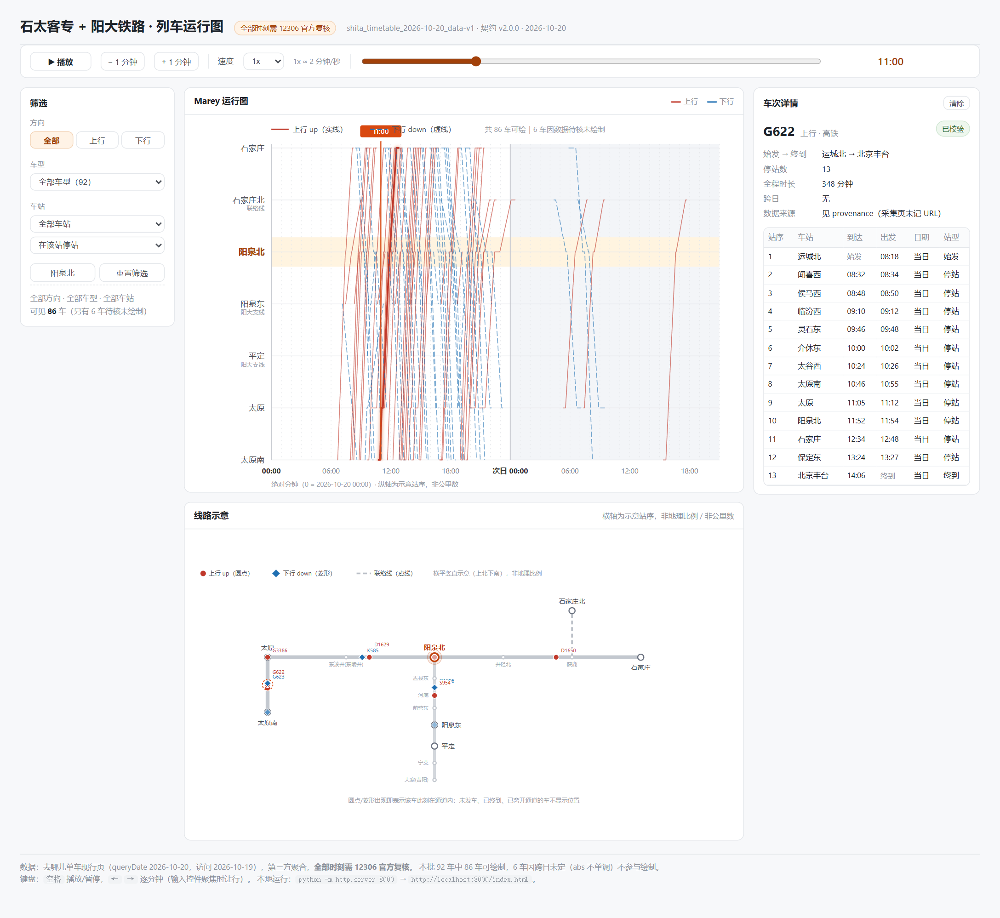

# 石太客专 + 阳大铁路 · 列车运行图

一个**本地打开、无框架、无 CDN、无构建**的列车运行图可视化页面：左边 Marey 运行图，右边线路示意，两个视图由同一个播放时钟驱动。

> ⚠️ **数据性质**：时刻取自 **12306 官方前端接口**（余票查询 `leftTicket` + 经停站查询 `queryByTrainNo`，服务日 2026-10-20，采集于 2026-10-19），不再是第三方聚合。车辆开行状态以查询当日为准。



---

## 快速开始

**方式一：一键启动（推荐）**

双击根目录的 **`start.bat`** —— 自动起本地服务并打开浏览器。
命令行用法：`start.bat`（主页）/ `start.bat record`（录制页）/ `start.bat index 8010`（指定页面和端口）；
端口已被占用时自动只开浏览器不重复起服务；找不到 Python 会给出明确提示。

**方式二：手动**

```bash
# 在项目根目录
python -m http.server 8000
# 浏览器打开
http://localhost:8000/index.html        # 完整页（筛选 + 详情 + 两视图）
http://localhost:8000/record.html       # 录制页（全屏线路动画 + 播放器式控制条，用于录屏）
```

**为什么不能双击打开**：页面用 `fetch()` 读取独立 JSON，浏览器在 `file://` 下会拦截（CORS）。
双击 `index.html` 会显示明确提示而不是白屏，但看不到图。若最终必须"双击即用"，见 §7 的离线打包方案（尚未实施）。

---

## 功能

| 功能 | 说明 |
|---|---|
| Marey 运行图 | 横轴绝对分钟（0 = 2026-10-20 00:00，覆盖到次日 21:00），纵轴 7 行（太原/太原南、石家庄/石家庄北 分开）；上行实线红、下行虚线蓝 |
| 线路示意 | **横平竖直**示意图（上北下南）：`太原—东凌井—阳泉北—井陉北—获鹿—石家庄`；石家庄北经**石太普铁**（获鹿—石家庄北，虚线）接入；太原南在太原正南、阳泉东在阳泉北正南；车底点**沿轨道折线**行走 |
| 播放器 | 播放/暂停、时间轴拖动、±1 分钟、0.5x / 1x / 2x / 5x；`空格` 播放暂停、`←` `→` 逐分钟 |
| 筛选 | 方向、车型（按数据动态生成）、车站在该站停站/通过；两个视图始终同一批车 |
| 车次详情 | 逐站到发、`day_offset`、站型（始发/终到/停站/通过）、备注与待核告警；缺失显示「未知/始发/终到」，绝不显示 00:00 |
| 数据状态 | 只绘制 `usable_for_frontend = true` 的 155 车；4 车因停站跨午夜（绝对分钟不单调）不绘制，界面上有明确说明 |
| 录制页 `record.html` | **默认全屏线路动画**（逻辑 viewBox 缩小 `zoom` 倍再 CSS 拉伸，车底/轨道/标签整体放大且矢量无损）；悬浮控制条（播放/进度/倍速/视图/全屏），鼠标静止 2.6s 自动隐去控件与光标，`H` 锁定纯画面，`F` 全屏；左上角常驻**大号当前时刻**（跨日自动标「次日」）；参数 `?view=line/marey/both&t=600&from=180&to=1920&autoplay=1&speed=5&zoom=3&fs=1.35&bigtime=0&corner=0` |

时间换算常量：**1x = 2 模拟分钟 / 秒**（`js/player.js` 的 `minutesPerSecond`，全项目唯一来源）。

---

## 目录结构

```
.
├─ index.html                 # 最终页面（两个视图 + 播放器 + 筛选 + 详情）
├─ record.html                # 录制页（全屏播放器式，悬浮控制条自动隐去）
├─ marey-demo.html            # 阶段4 模块演示（非最终页，保留备查）
├─ line-demo.html             # 阶段5 模块演示（非最终页）
├─ css/
│  ├─ demo.css                # 页面外壳与两个演示页共用
│  ├─ app.css                 # 最终页布局
│  └─ record.css              # 录制页样式
├─ js/
│  ├─ marey-chart.js          # 运行图模块（不依赖播放器）
│  ├─ line-diagram.js         # 线路示意与位置插值
│  ├─ player.js               # 统一时间控制器（单 rAF）
│  └─ interactions.js         # 筛选规则 + 详情渲染
├─ data/
│  ├─ raw/                    # 原始 CSV（只读，不公开分发）
│  ├─ processed/              # 清洗后的正式 JSON（前端唯一数据源）
│  └─ test-fixtures/          # synthetic 测试数据（data_kind=synthetic）
├─ scripts/
│  ├─ collect_12306.py        # 12306 前端接口采集（余票 + 经停站）→ 契约 CSV
│  ├─ clean_timetable.py      # CSV → 契约 JSON（SHITA_PROFILE=v2 切换数据源 profile）
│  ├─ validate_contract.py    # Schema + 语义不变量校验
│  ├─ diff_datasets.py        # v1↔v2 差异对比
│  ├─ test_pure.mjs           # 纯函数回归（22 项）
│  ├─ test_e2e.mjs            # 端到端验收（43 项，需 playwright-core）
│  └─ test_record.mjs         # 录制页截图与行为自检（playwright-core）
├─ docs/
│  ├─ data-contract.md        # JSON 契约 v2.0.0
│  ├─ schema/                 # JSON Schema 2020-12
│  ├─ stations.md             # 车站骨架（示意顺序、办客、待核）
│  ├─ test-plan.md            # 测试计划与用例
│  ├─ modules/                # 两个视图模块说明
│  └─ templates/              # 缺陷/验收报告模板
└─ reports/
   ├─ sources/                # 来源记录
   ├─ manual_review/          # 待核与冲突（CSV + Markdown）
   └─ validation/             # 清洗校验、契约冻结、测试报告
```

---

## 数据

| 项 | 值 |
|---|---|
| 服务日 | 2026-10-20（现行图） |
| 车次 | **159 个物理交路**，2125 条站记录，439 个站名（含跨线远端站） |
| 可绘制 | **155 车**（4 车跨午夜停站被阻断） |
| 来源 | 12306 官方前端：`leftTicket/queryG` + `queryByTrainNo`（20 组 OD 并集，159 次经停站查询，2 跳过均为京原线） |
| 里程 | 全部 null（12306 前端无里程），纵轴为示意站序，**不是公里数** |
| 原始 CSV | `data/raw/shita_train_timetable_2026-10-20_data-v2_12306.csv`（335,707 B，SHA-256 `7abfc727dd33b7c9a57374fb75bd02f0bf7957524ba2c8bc72fe6d1e6cd1a88e`） |
| 正式 JSON | `data/processed/shita_timetable_2026-10-20_data-v2.json`（3,964,620 B，SHA-256 `2449cea12494315ec6175530fd10409afafe4b2be30a229945008cb31d44f0d0`） |
| 旧数据 | data-v1（去哪儿聚合，92 车 / 1132 行）保留，前端已切到 v2 |

来源与采集通道见 `reports/sources/sources_2026-10-20_data-v2.md`，原始响应留证在 `data/raw/_12306_raw/2026-10-20/`。
v1→v2 差异见 `reports/manual_review/data-v1_to_v2_diff.md`：**88 个同编号车次的逐站到发时刻 100% 一致**，v2 多出 98 车。
数据契约（字段含义、ID 规则、版本规则）见 `docs/data-contract.md`（**v2.0.0**：站点用 `place` 描述示意坐标与支线挂接）。

### 重建数据

```bash
python scripts/collect_12306.py --reuse-raw   # 复用已缓存响应重建 CSV（改后处理逻辑时用）
python scripts/collect_12306.py               # 重新联网采集（约 4 分钟，159 次请求）
SHITA_PROFILE=v2 python scripts/clean_timetable.py   # CSV → 契约 JSON
python scripts/validate_contract.py --all
```

采集与清洗脚本都不覆盖原始 CSV；输入哈希写在 JSON 的 `provenance.csv.sha256`。

---

## 测试

```bash
node scripts/test_pure.mjs        # 22 项，无需浏览器
node scripts/test_e2e.mjs         # 43 项，需 playwright-core + 本机 Chromium 内核浏览器
python scripts/validate_contract.py --all
```

结果见 `reports/validation/test_report_2026-10-19.md`（41 + 19 + 契约校验全通过）。
端到端脚本默认使用 Edge 与一处本机 playwright-core 路径，可通过环境变量覆盖：

```bash
BROWSER_PATH="C:/Program Files (x86)/Microsoft/Edge/Application/msedge.exe" \
PLAYWRIGHT_CORE="C:/path/to/node_modules/" node scripts/test_e2e.mjs
```

---

## 已知限制

1. **4 车无法绘制**：K214 / K546 / K892 / T175 在走廊内有停站跨午夜（如石家庄北 23:57 到、00:07 开），契约每站只有一个 `day_offset`，无法同时表达到达日与出发日，`abs_minute` 不单调，故阻断而不篡改时刻。
2. **同一物理交路只录一个车次号**：12306 的 `train_no` 是车底交路，一趟车中途换号（如 D1152→D1153）。本批只录一条，别名写进 remark。
3. **12306 只返回营业停站**，不返回通过站；相邻营业站之间的经由按线路骨架 BFS 路径绘制。
4. **km 全缺**，纵轴只能按站序示意；不得据此估算距离。
5. **负 `day_offset` 是正常的**：v2 录的是「10-20 经过走廊」的车，长途车前一日始发（如 D16 成都东 10-19 15:37），这部分时刻落在时间轴 0 点之前，图外不绘制。
6. **`file://` 不支持**，必须本地 HTTP；离线单文件方案尚未实施。
7. v1 的 D918 不在 v2：12306 显示该车 2026-10-20 当日不开行（v1 的 uncertainties 亦记载 10/20–22 停运）。

---

## 版本规则

- **数据版本**：当前 `data-v2`（12306 官方前端）；`data-v1`（去哪儿聚合）保留对照，前端已切到 v2。重建会改变 SHA-256，需登记。
- **契约版本**：`2.1.0`（v2 数据）/ `2.0.0`（v1 数据）；2.1.0 仅放宽 `day_offset` 与 `abs_minute` 可为负，其余不变。删字段/改语义升 MAJOR，加可选字段/放宽约束升 MINOR。
- **页面版本**：`web-v1.4.0`（数据源切到 12306、页脚统计改为动态）。
- **采集脚本**：`scripts/collect_12306.py` v1.0.0；清洗脚本 v1.1.0（v2 profile）与 v1.0.0（v1 profile，保证旧数据重跑字节一致）。

详细映射见 `docs/version-history.md`，归档清单见 `docs/archive-manifest.md`。
