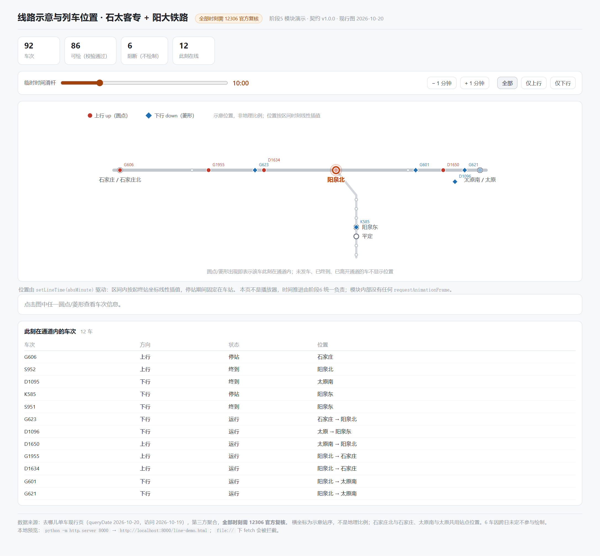

# 模块说明 · js/line-diagram.js（线路示意与列车位置）

> 版本 **1.2.0**（阶段5；2026-10-19 改为横平竖直 + 沿轨寻路）｜契约：`docs/data-contract.md` v2.0.0｜演示页：`line-demo.html`
> 只做线路示意与位置插值，**不做播放器、不解析 CSV、不改契约、不自建动画循环**。

---

## 1. 边界

| 做 | 不做 |
|---|---|
| 画线路、车站、列车标记，按传入时间算位置 | 不自己 `requestAnimationFrame` / `setInterval` 推进时间 |
| `setLineTime(absMinute)` 响应外部时钟 | 不实现播放/暂停/倍速（阶段6） |
| 点击/回车派发 `trainselect` | 不写详情弹窗、不做筛选面板（阶段7） |
| 缺站/缺时刻的区间跳过并计数 | 不插值造时刻、不猜地理位置 |

---

## 2. 坐标从哪来

站点位置**不写死**，由 `stations[].place` 的归一化示意坐标 `(x, y)` 换算到 viewBox：

- `x` 0 = 最西，1 = 最东；`y` 0 = 最北，1 = 最南。**上北下南、左西右东**。
- 坐标按 **横平竖直** 取值：同一条线上的站共用一个 `y`（主线）或一个 `x`（支线），相邻站之间只有水平/垂直段。

本批布局（近似）：

```
                                          石家庄北
                                             ┆   石太普铁（虚线）
太原 —— 东凌井 —— 阳泉北 —— 井陉北 —— 获鹿 —— 石家庄
 |                          |
太原南                   盂县东
                           |
                         河底 / 荫营东
                           |
                         阳泉东
                           |
                         平定 / 宁艾 / 大寨
```

- 太原南在太原正南（`x` 相同），石家庄北在石家庄正北。
- 阳大支线在阳泉北正南，垂直向下。
- 无停站记录的骨架站（获鹿/井陉北/东凌井/盂县东…）画成灰点 + 9.5px 灰字。

### 2.1 轨道图与寻路

- `buildLayout` 额外生成 `edges`（每条是横平竖直折线）与邻接表，并提供 `route(fromId, toId)`：在轨道图上 BFS 找唯一路径，返回折线几何与长度。
- 车次区间不再用「两站直线插值」，而是 **沿 route 的折线按弧长取点**；例如 C800 阳泉北→石家庄北 会走 阳泉北→井陉北→获鹿→石家庄北（石太普铁），而不是斜穿。
- 若坐标未对齐，`orthoGeometry` 会兜底成「先横后竖」的折线，保证永不出现斜轨。

> v1 按 1D 槽位等距、合并同城站；v2.0 按 `place` 摆位；v1.2.0 起强制横平竖直并沿轨行走。

## 3. 区间（legs）与状态机

### 3.1 只取"相邻且都在图上"的区间

`segments` 是按相邻停站生成的，因此只要两端 `station_id` 都在示意图上，这一段就是真实的相邻区间；任何一端在通道外（保定、天津、徐州…）就整段跳过并计入 `skippedSegments`。**不会出现跨过未映射站硬连一条线的情况。**

- `run`：`start = departure_abs_minute`，`end = arrival_abs_minute`。
- `dwell`：`start = arrival_abs_minute`，`end = departure_abs_minute`（注意 dwell 的 departure 比 arrival 大）。
- `end < start` 的区间（跨日未定车）直接跳过。

### 3.2 位置 = 纯函数

```
p = (t - leg.start) / (leg.end - leg.start)     // 0..1
x = from.x + (to.x - from.x) * p
y = from.y + (to.y - from.y) * p
```

同一时间输入必得同一位置，与帧率无关；跨日只比较绝对分钟，没有任何 `% 1440`。

### 3.3 七种状态（对外 `data-state`）

| state | 判定 | 是否显示 | 行为 |
|---|---|---|---|
| `off_corridor` | 没有任何通道内区间 | 否 | — |
| `pending` | `t < 首段 start` | 否 | 不显示为已发车 |
| `between` | 落在两段之间（中间经过通道外站） | 否 | 不跨缺口画 |
| `moving` | `start ≤ t ≤ end` 且为 run | 是 | 区间线性插值 |
| `stopped` | `start ≤ t ≤ end` 且为 dwell | 是 | 固定在车站 |
| `terminal` | `t > 末段 end` 且终到站在通道内 | 是（opacity 0.5） | 停在终点，不常驻标签 |
| `left` | `t > 末段 end` 且终到站在通道外 | 否 | 已驶离本图范围 |

`endBehavior` 可配 `'hold'`（默认，终到停住）或 `'hide'`（到站即消失），行为全局一致。

---

## 4. 公开接口

```js
const d = LineDiagram.initLineDiagram(container, data, options);
```

| 方法 | 说明 |
|---|---|
| `setLineTime(absMinute)` | 外部时钟每帧调用；只改已有标记的 `transform/opacity/display`，不重建 DOM |
| `setVisibleTrains(ids\|null)` | 支持 `train_id` 或 `train_no`；`null` = 全部 |
| `setSelectedTrain(trainId\|null)` | 显示/隐藏选中环 |
| `resize()` / `destroy()` | 重绘 / 清理 |
| `getLayout()` | 调试：节点坐标、共用槽位映射 |
| `getActiveTrains()` | 当前可见车次 `[{trainId, trainNo, direction, state, station, fromStation, toStation, progress}]` |
| `getTrainStates()` | 全部车次的 `{trainNo, state}`，用于两视图一致性核对 |

事件（在 `container` 上）：

```js
container.addEventListener('trainselect', e => {
  // e.detail = { trainId, trainNo, direction, trainType, usable, status }
});
```

`options`：`height`(400) / `mainY`(150) / `branchOffset`(46) / `branchTop`(196) / `branchBottom`(342) /
`showLabels`(true) / `showBlocked`(false) / `endBehavior`('hold') / `colors`。

> `showBlocked` 默认 false：6 车 `abs_minute` 不单调，与 Marey 图口径保持一致，不画。

---

## 5. 渲染与性能

- SVG 只建一次：线路 → 车站 → 图例 → 86 个车次组。每帧只改 `transform`、`opacity`、`display`。
- 每个车次组 = 透明 13px 命中圆 + 选中环 + 标记（上行圆点 / 下行菱形）+ 车次标签 + `<title>`。
- 标签**三层错位**：同一行内 x 间距 < 46px 时依次上移 11px（只动标签，不动标记位置），避免 12 车重叠成一团。
- 终到车在端点不常驻标签（hover 时恢复），否则终点站会堆 3–5 个标签。
- 上下行用「颜色 + 形状」双编码（圆点/菱形），不依赖颜色单一通道。

---

## 6. 与 Marey 图的一致性

两个视图都只消费 `abs_minute`，且都以 `usable_for_frontend` 过滤阻断车，所以同一时刻：

- Marey 图上折线覆盖的时间段 = 线路图上 `moving/stopped` 的时间段；
- 未发车（`pending`）的车在两个视图都不出现；
- 驶离通道（`left`）的车在线路图消失，Marey 图的折线也在通道边界终止。

`getTrainStates()` 可在阶段7 做逐车对拍。

---

## 7. 演示页（`line-demo.html`）



- 时间滑杆 + ±1 分钟（验证整数分钟与插值）；
- 方向筛选（验证 `setVisibleTrains`）；
- 「此刻在通道内的车次」表：车次、方向、状态、位置，与图上标记一一对应；
- 点击标记显示车次详情并高亮选中环。

启动：

```bash
python -m http.server 8000
# http://localhost:8000/line-demo.html
```

---

## 8. 验收记录（2026-10-19）

Playwright（headless Edge）驱动真实页面，**15 项全 PASS**：

| # | 验收项 | 结果 |
|---|---|---|
| 1 | 渲染标记数 = 86（仅可用车次） | PASS |
| 2 | 未发车时隐藏（S951 @09:19） | PASS |
| 3 | 发车瞬间位于起点（581.60,150） | PASS |
| 4 | 区间中点线性插值（574 → 604.6,214.7） | PASS |
| 5 | 终到停在终点且半透明（627.6,279.4 / opacity .5） | PASS |
| 6 | 停站固定在车站（C800 @阳泉北） | PASS |
| 7 | 驶离通道后隐藏（C800 @10:00） | PASS |
| 8 | 跨日按绝对分钟定位（K1331 @00:10 次日 → 石家庄） | PASS |
| 9 | 跨日驶离后隐藏 | PASS |
| 10 | 可见标记数 = 列表行数 = 计数（12/12/12） | PASS |
| 11 | 仅上行筛选（5 车，方向全为 up） | PASS |
| 12 | 真实鼠标点击标记 → 详情 + 选中环 | PASS |
| 13 | 键盘 Enter 可选择 | PASS |
| 14 | 状态机取值合法（全部 86 车） | PASS |
| 15 | 页面无 console/page error | PASS |

纯函数断言（Node）：`pending/moving/stopped/terminal/left` 边界、dwell 的起止方向、跨日 1450 不回绕、逐分钟位移连续（K1331 最大 7.2px/分钟，无跳变）。

---

## 9. 已知限制

1. **支线竖向排列**：阳泉东与平定按 `order` 均分只有 21px 间距，标签靠右侧显示；若未来盂县东等站有了数据会变密，届时需改为可折叠或分组显示。
2. **D1095 的斜线**：阳泉东→太原南 在图上是一条斜线，因为页面缺阳泉北（契约 `ROUTE_PENDING`），不是插值错误。
3. **端点标签**：终到车不常驻标签，需要 hover 或看下方列表；这是为了避免 3–5 个标签叠在太原南。
4. **不支持地图语义**：没有经纬度、没有真实比例，也不应据此估算距离。
5. 标签错层最多 3 层；极端时刻（如 08:00–09:00 高峰）仍可能有轻微重叠。
