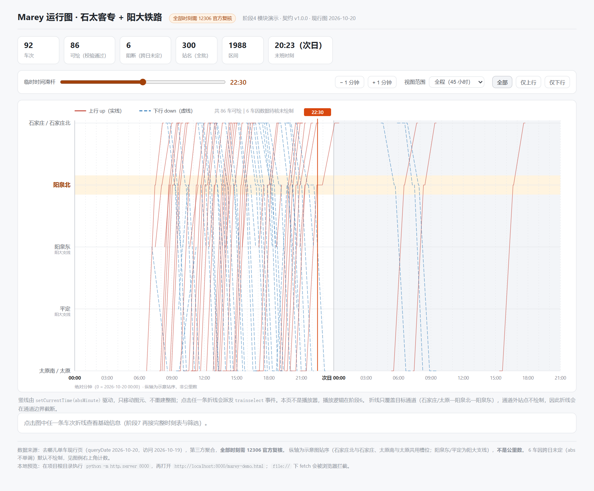

# 模块说明 · js/marey-chart.js（Marey 运行图）

> 版本 **1.1.0**（阶段4；2026-10-19 站点拓扑拆分）｜契约：`docs/data-contract.md` v2.0.0｜演示页：`marey-demo.html`
> 只做绘图与交互事件，**不做播放器、不解析 CSV、不改契约**。

---

## 1. 边界

| 做 | 不做 |
|---|---|
| 读契约 JSON，画 SVG 折线、时间轴、车站轴 | 不读 `data/raw/*.csv` |
| 提供 `setCurrentTime` / `setVisibleTrains` / `setDomain` 等接口 | 不自己起 `setInterval` / `requestAnimationFrame` 播放 |
| 点击/回车派发 `trainselect`（10px 透明命中区，1px 细线也点得中） | 不写详情弹窗、不做筛选面板 |
| 缺失/未映射数据断线并记录原因 | 不插值补时刻、不给 km 编值 |

---

## 2. 依赖的运行前提（来自契约）

1. `trains[].validation.usable_for_frontend === true` 的车才画；`false`（6 车跨日未定）默认不画。
2. 纵轴只认 `stations[].place`；`place` 为 null 的站（如 `昔阳`）**不占行**，经过它的车在该处断线。
3. 时间只用 `stops[].abs_minute`；`arr_time/dep_time` 字符串不参与任何比较。
4. `km` 全为 null，纵轴是**示意站序**，不是里程。

---

## 3. 公开接口

```js
const chart = MareyChart.initMareyChart(containerEl, data, options);
```

| 方法 | 说明 |
|---|---|
| `setCurrentTime(absMinute)` | 移动时间竖线；**只改 cursor 图层的 transform 与文字**，不重建 SVG；超出当前 domain 时隐藏 |
| `setVisibleTrains(ids)` | `null` = 全部；数组元素可为 `train_id`（`tr:C800`）或 `train_no`（`C800`）；其余置 `display:none` |
| `setSelectedTrain(trainId)` | 选中高亮（与线路图联动，`null` 取消） |
| `setDomain(minAbs, maxAbs)` | 缩放到时间窗口（如 3 小时）。会重绘刻度，但不重算折线数据 |
| `setOption(patch)` | 覆盖 options（`height` / `colors` / `showBlocked` 等）并重绘 |
| `resize()` | 容器宽度变化后重绘（内部已用 `ResizeObserver` 去抖 120ms） |
| `destroy()` | 断开 observer、清空 DOM |
| `getLayout()` | 调试用：返回 `{axis, domain, series, width, height}` |

事件：在 `container` 上监听

```js
container.addEventListener('trainselect', e => {
  // e.detail = { trainId, trainNo, direction, trainType, usable, status }
});
```

`options` 默认值（节选）：

```js
{
  height: 640,
  margin: { top: 46, right: 28, bottom: 46, left: 122 },
  domain: null,            // null = 按 meta.coverage 取整到整点
  showBlocked: false,      // 阻断车默认不画；开启后灰色虚线画出
  colors: { up:'#c0392b', down:'#1f6fb2', blocked:'#8a8f98' },
  dash:   { up:'none', down:'7 4', blocked:'2 4' }
}
```

---

## 4. 坐标系与轴

### 4.1 横轴（时间）

- 线性映射：`x = margin.left + (absMinute - d0) / (d1 - d0) * plotWidth`。
- 默认 domain 由 `meta.coverage` 决定：`[floor(min/60)*60, ceil(max/60)*60]` = **`[0, 2700]`**（当日 00:00 → 次日 21:00）。
- 为什么不是总纲写的"次日 06:00"：本批 166 个时刻 > 1800，硬截会丢车（见契约 §3）。
- 刻度与标签间隔按像素自适应（标签间距 ≥ 64px，从 `10/15/30/60/120/…/720` 分钟里选），缩放后不会挤成一团。
- 1440 处画加粗分隔线并标"次日 00:00"，次日区域加浅灰底；次日刻度只写 `HH:mm`，避免 `+1d` 前缀挤占宽度。

### 4.2 纵轴（车站）

由 `stations[].place` 生成，**不硬编码站名、不再合并同城车站**：

1. 主线：取 `place.sequence` 非空且无 `branch_of` 的站，按 `sequence` **降序**（东在上、西在下）。
2. 支线：按 `branch_of` 挂到父站，`branch_order` 排序；父站以北方（`place.y` 更小）的支站插在父站上方，其余插在下方。递归处理二级支线（平定→阳泉东）。**父站没有停站记录时（如获鹿），父站不成就行，但支线子站仍按位置插入。**
3. 只保留 `stop_records > 0` 或 `is_highlighted` 的行；父站无停站但有子站保留时，父站降级为 minor 行。

本批结果 7 行：

```
石家庄
石家庄北（联络线，挂在获鹿下，获鹿无停站故不单独成行）
阳泉北（高亮）
阳泉东（阳大支线）
平定（阳大支线）
太原
太原南
```

> v1 曾把「石家庄/石家庄北」「太原/太原南」合并成一行（标签 `A / B`），导致「到太原」与「到太原南」无法区分、5 车双停信息被抹掉。v2.0.0 拆开后，双停车次会在两行之间画出一段近乎竖直的折线（糖葫芦串珠）。

## 5. 折线构造（这是"不造假线"的关键）

`buildSeries(train, axis)` 逐站生成点：

```
对每个 stop：
  1. 站不在轴上行内（未映射） → 记 skipped，flush 当前段，断开
  2. arr/dep 都为 null        → 记 missing，flush，断开
  3. 有点：arr 有点就加 (arr, y)；dep 有且 ≠ arr 再加 (dep, y)
  4. y 相同 → 水平线段（停站）；y 不同 → 斜线（区间运行）
```

- **断线而非跨接**：遇到未映射站或缺时刻，当前段在此结束，后面的点另起一段。`path` 用 `M...L...` 多段拼接，绝不跨缺口连一条假线。
- 通过站（`arr === dep`）只产生一个点，不产生 0 分钟水平线。
- `hasBackwards` 只做记录（跨日异常），不改值；阻断车默认不进入渲染。
- 通道外站点（如 保定、天津、徐州…）不占行 → 折线在通道边界（石家庄/太原）自然截断，这是"只画目标两区间"的预期行为。

---

## 6. 渲染层次与性能

SVG 图层顺序（自下而上）：

```
次日底色 → 行底纹/行线 → 车站标签 → 时间网格/刻度 → [裁剪] 车次折线 → 时间光标 → 图例
```

- 折线层套 `clipPath`，缩放窗口时不会画到站名区。
- `setCurrentTime` 只更新 `<g class="mc-cursor">` 内 3 个图元的 `transform` 和文字，**不触碰折线**；实测连续调用后 `<path d>` 与 SVG 子节点数不变。
- `setDomain` / `resize` 会重绘（86 条 path 量级，单次 < 30ms），演示页对窗口跟随做了 80% 死区，拖动滑杆不会每帧重绘。
- `ResizeObserver` 去抖 120ms，宽度变化 < 24px 不重绘。

---

## 7. 可读性与可访问性

- 上下行**颜色 + 线型双编码**：上行实线红、下行虚线蓝，并提供图例；色觉障碍用户仍可凭线型区分。
- 每条折线有 `<title>`（车次/车型/方向/未绘站数）与 `aria-label`，`tabindex=0`、`role=button`；回车/空格触发 `trainselect`。
- 鼠标悬停在折线上时，其余折线压暗到 0.25，缓解 86 条线的重叠。
- 阳泉北行有浅橙色底 + 加粗标签。
- 图内固定声明"绝对分钟 / 纵轴为示意站序，非公里数"。

---

## 8. 演示页（`marey-demo.html`）



> 上图：全程 45 小时视图，时间游标 22:30，次日区域为浅灰底。日常查看建议切 3 小时窗口。

不是最终页面，只用于阶段4 验收：

- 顶部统计：92 车 / 86 可绘 / 6 阻断 / 1988 区间。
- 临时时间滑杆 + `±1 分钟`（验证整数分钟与竖线更新，**不是播放器**）。
- 视图范围：全程 45h / 6h / 3h / 1.5h 窗口（验证 `setDomain` 与刻度自适应）。
- 方向筛选（验证 `setVisibleTrains`）：全部 86、上行 43、下行 43。
- 点击折线 → 详情区显示车次、方向、类型、状态、通道内各站到发（阶段7 会替换为完整时刻表）。

启动：

```bash
cd "D:/Code/Vibe coding test/石太客专列车运行图"
python -m http.server 8000
# 打开 http://localhost:8000/marey-demo.html
```

> `file://` 直接双击会被浏览器拦截 fetch，页面会显示明确提示，不会白屏。

---

## 9. 验收记录（2026-10-19）

自动化：Playwright（headless Edge）驱动真实页面，18 项全部通过。

| # | 验收项 | 结果 |
|---|---|---|
| 1 | 渲染折线数 = 86（仅 `usable_for_frontend`） | PASS |
| 2 | 纵轴 5 行且站名正确（含共用槽位） | PASS |
| 3 | 阳泉北行高亮 | PASS |
| 4 | 阳大支线标注 2 处 | PASS |
| 5 | `setCurrentTime` 不重建折线（`d` 与子节点数不变） | PASS |
| 6 | 时间竖线随 `setCurrentTime` 移动 | PASS |
| 7 | 时间读数同步 | PASS |
| 8 | `+1 分钟` 精确 +1 | PASS |
| 9 | `−1 分钟` 精确 −1 | PASS |
| 10 | 仅上行 = 43（46 − 3 阻断） | PASS |
| 11 | 仅下行 = 43 | PASS |
| 12 | 全部 = 86 | PASS |
| 13 | 点击派发 `trainselect`，detail 含 `trainId/trainNo` | PASS |
| 14 | 详情面板显示车次与方向 | PASS |
| 15 | 真实鼠标点击命中折线（走 10px 透明命中区） | PASS |
| 16 | 键盘 Enter 可选择 | PASS |
| 17 | 阻断车不在 DOM 中（不画） | PASS |
| 18 | 窄屏（900px）重绘后仍 86 条 | PASS |

纯函数断言（Node，无 DOM）：未映射站断线、缺时刻断线、通过站单点、次日 `1450` 不回绕、时间域取整 —— 全部通过。

---

## 10. 已知限制

1. **通道外站点不绘制**：1132 条站记录中只有 265 条落在 5 个通道行上；其余属长交路远端，按设计不画。详情面板可看全程。
2. **支线摊平**：阳大支线行插在阳泉北之后，`平定→太原` 会跨越支线行，形状上像折返，但站序与时刻未被改动。
3. **阻断车不参与绘制**：K373/K374/K565/K609/K730/K866 的 `abs_minute` 不单调，画出会出现倒流。契约要求先由 12306 核定 day_offset。
4. **不支持拖拽平移**：目前用"视图范围 + 滑杆"控制窗口；阶段6 播放器若需要"跟随当前时间"，调用 `setDomain` 即可，无需改本模块。
5. `showBlocked: true` 可强制显示阻断车（灰色虚线），仅供排查，不建议在正式视图开启。
